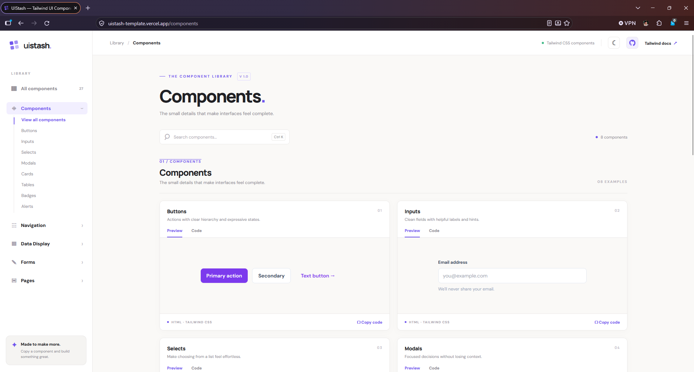
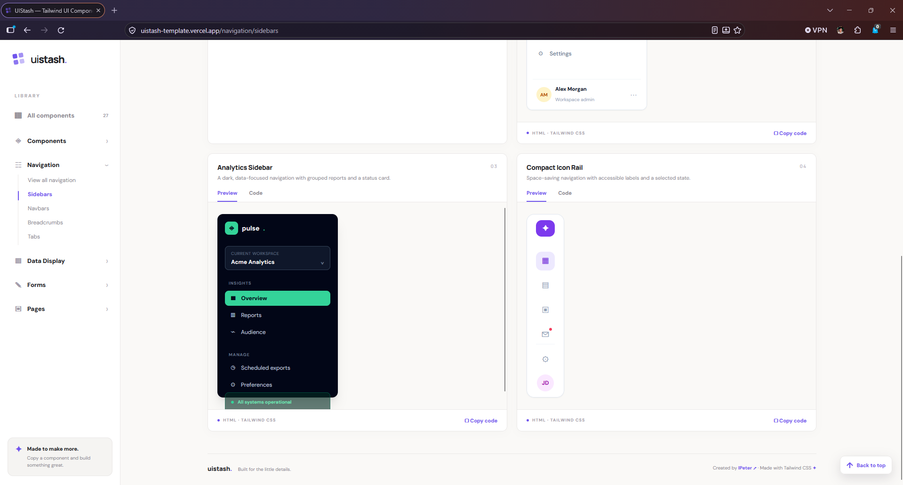
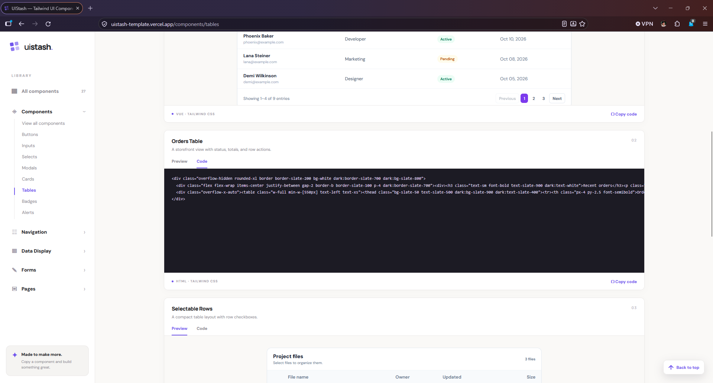
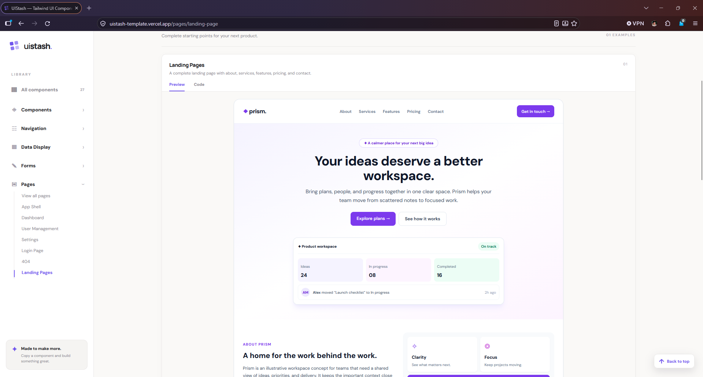

# UIStash.

**Stack of reusable UI components.**

A collection of ready-to-use HTML and Tailwind CSS components. Browse, preview, and copy beautifully crafted UI elements to build websites faster.

**[Explore UIStash](https://uistash-template.vercel.app/)**

---

## Preview

## About UIStash

UIStash is a growing collection of reusable UI components and templates built with HTML and Tailwind CSS.

Designed for developers who want to spend less time creating repetitive interfaces and more time building their applications.

Simply browse the library, preview a component, copy its code, and paste it into your project.

**No component library installation required.**

## Features

- **Ready-to-use Components** — Prebuilt HTML and Tailwind CSS elements.
- **Live Preview** — See components before copying their code.
- **Copy & Paste** — Quickly integrate components into your projects.
- **Responsive Design** — Components designed for different screen sizes.
- **Organized Library** — Easily explore components by category.
- **Customizable** — Modify colors, spacing, typography, and layouts to fit your project.
- **Developer-Friendly** — Simple code that is easy to understand and reuse.

## Component Categories

| Category | Description |
|---|---|
| Components | Buttons, inputs, cards, badges, modals, and more |
| Navigation | Sidebars, navigation bars, tabs, and menus |
| Data Display | Tables, statistics, and other data presentation elements |
| Forms | Login forms, registration forms, and form elements |
| Pages | Ready-made page layouts and templates |

The library will continue to grow with additional components and templates.

## How to Use

1. Visit **[UIStash](https://uistash-template.vercel.app/)**.
2. Browse the available component categories.
3. Select a component and preview its design.
4. Click **Copy Code**.
5. Paste the code into your HTML or Tailwind CSS project.
6. Customize the component to match your application's design.

> Make sure Tailwind CSS is configured in your project before using the components.

## Technologies

UIStash uses the following technologies:

- Next.js
- React
- TypeScript
- Tailwind CSS

The component examples are intended to be easy to copy and integrate into Tailwind CSS projects.

## Repository Information

This repository contains the public documentation, project information, and visual assets for UIStash.

The application's source code is maintained in a separate private repository.

You can access the live component library through the official website.

**Live Website:** https://uistash-template.vercel.app/

## Feedback & Suggestions

Have an idea for a new component or found an issue?

Feel free to open a GitHub Issue to share feedback, suggest improvements, or request additional UI components.

## License

See the [LICENSE](LICENSE) file for the licensing terms applicable to this repository.

---

**UIStash — Stack of reusable UI components.**

*Build faster. Copy smarter.*